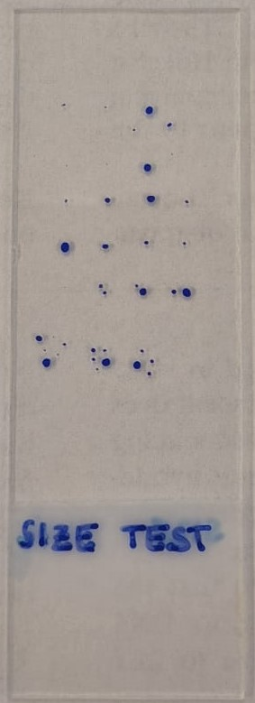
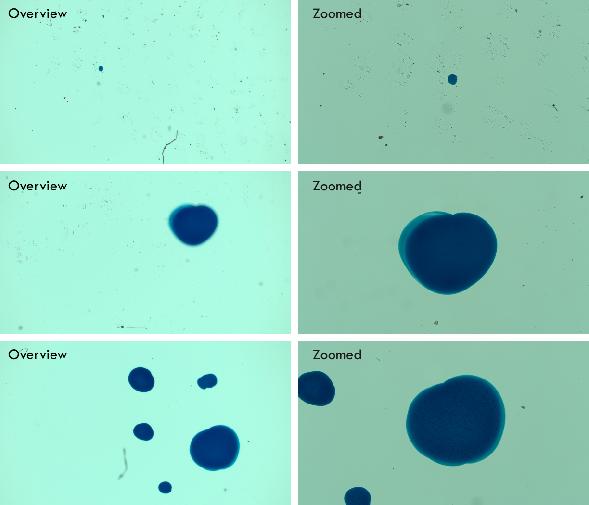

# Test Data

Here is the data obtained from the different tests performed using the Microscope Control system developed:

- [Size Test](#size-test)
    - [Identify Largest Spot](#identify-largest-spot)
- [Fixed Cell Detection](#fixed-cell-detection)
    - [Fixed Cell Mitosis Detection](#fixed-cell-mitosis-detection)

# Size Test

The size test experiments were performed on a slide (see image below) onto which dots of differing sizes have been drawn with a marker.  The goal is to evaluate the performance of the segmentation and measurement algorithm based on its ability to discern the desired spots and zoom into them while keeping them centered.

## Identify Largest Spot
In order to identify the largest spot the identified image objects are filtered based on their perimeter, and the microscope zooms into the centre of mass (CoM) of the object with the largest perimeter. This is done through the `find_largest_centre_com` function in [functions_imageJ_interact.py](../ZenAPI/functions_imageJ_interact.py).

After running the experiments we obtain the following images:

Multiple timepoints were taken of the same positions and times were measured and averaged to answer the following four questions:

1) How long does it take to complete 1 full timepoint? (This includes images + zoomed in timelapses of all set positions, 5 in this case)
2) How long does the image analysis through pyimagej take?
3) How long does it take to identify the largest object and find its centre?
4) How long does the switch to and from higher resolution take? (This includes switching of objectives and moving the stage)

The table [Timing_data.csv](./Timing_data.csv) contains the individual measurements as well as the averaged measurements of an experiment with 3 timepoints containing 5 positions each, where the average measurements for each of the questions are:
1) 378.652118 s
2) 2.896857 s
3) 0.003803 s
4) 6.525838 s

# Fixed Cell Detection
## Fixed Cell Mitosis Detection
